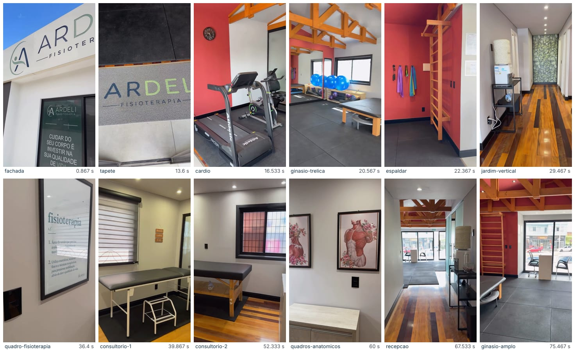
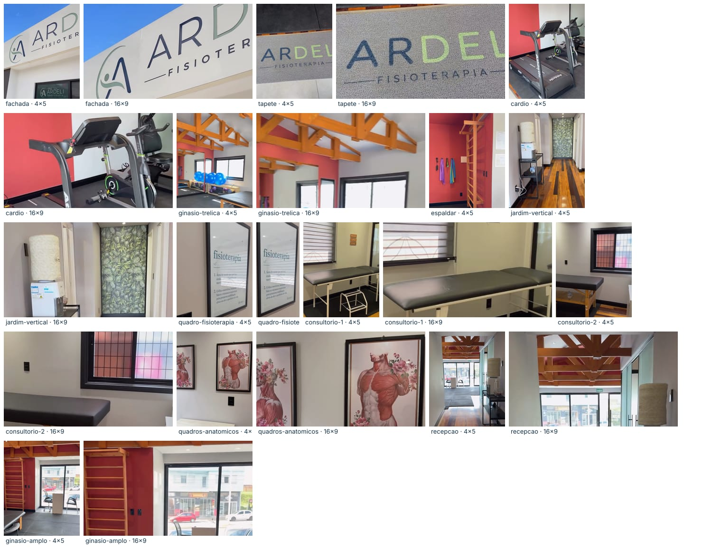

# Catálogo de mídia — Ardeli Fisioterapia

Versão 1 · 22/11/2026 · gerado na sessão "midia"

- **Fonte da verdade:** `media.manifest.json` (raiz). Este documento explica o que está lá.
- **Originais:** `media-originais/` (no git). **Derivados:** `public/media/` (fora do git), gerados por `pnpm media:prepare` (roda sozinho antes de `dev` e `build`).
- **Arquivos de trabalho** (quadros em PNG, cache): `.cache/media/` (fora do git e fora de `public/`, então nunca são publicados).
- **Índice para as páginas:** `public/media/media-index.json` (variantes, larguras, LQIP, vídeos, capítulos).

## 1. Regra de ouro

| Regra | Como o script garante |
|---|---|
| `naoUsar` nunca é publicado | o item é pulado; se um derivado antigo sobrar em `public/media/`, é apagado |
| Pessoa sem autorização nunca é publicada | trecho com `contemPessoa: true` é cortado do tour; loop, pôster ou still que caia nele faz o script **falhar** |
| Nunca acima do original | larguras 360/720 filtradas por `min(original, resolucaoMax)` |
| Vídeo sempre mudo | `-an` em todo derivado (música sem licença conhecida) |
| Sem IA | só corte, recorte, escala e correção global de cor; nada gerado nem ampliado por IA |

Testes em `tests/midia.test.ts` conferem tudo isso no manifesto e, quando `public/media/` existe, nos arquivos gerados.

## 2. Originais

| Id | Arquivo | Tipo | O que mostra | Uso | Máx. | naoUsar | Pessoa |
|---|---|---|---|---|---|---|---|
| `tour` | `videos/tour.mp4` | vídeo 720×1280, 30 fps, 79,5 s | a clínica inteira | tour, loops, pôsteres, stills | 1280 | não | **sim, em 4 trechos** (reflexo) |
| `captura-15-04-51` | `fotos/capturas/…15-04-51.png` | captura 382×506 | ginásio | referência | 360 | não | não |
| `captura-15-05-07` | `…15-05-07.png` | captura 381×509 | consultório 1 | referência | 360 | não | não |
| `captura-15-05-23` | `…15-05-23.png` | captura 381×511 | fachada em ângulo | "Como chegar" pequeno | 360 | não | não |
| `captura-15-05-48` | `…15-05-48.png` | captura 382×512 | cardio | referência | 360 | não | não |
| `captura-15-06-04` | `…15-06-04.png` | captura 381×506 | espaldar | referência | 360 | não | não |
| `captura-15-06-21` | `…15-06-21.png` | captura 384×507 | fachada de perto | referência (painel do carro embaixo) | 360 | não | não |
| `captura-15-06-42` | `…15-06-42.png` | captura 287×509 | consultório 2 | referência (só 287 px) | 360 | não | não |
| `arte-dia-do-fisioterapeuta` | `…15-52-14.png` | arte | Dia do Fisioterapeuta (Studio Ar + Ardeli) | texto em `docs/dados/textos-das-artes.md` | — | **sim** | não |
| `captura-logo-horizontal` | `…15-52-43.png` | logo raster | logo horizontal | substituído pelo SVG | — | **sim** | não |
| `arte-parceria-aapl` | `…15-56-33.png` | arte | "Nova parceria!" AAPL | texto em `textos-das-artes.md` | — | **sim** | não |
| `arte-unimed` | `fotos/SaveClip…857400492….jpg` | arte | "Agora atendemos Unimed!" | texto em `textos-das-artes.md` | — | **sim** | não |
| `logo-jpeg` | `fotos/logo.jpeg` | logo raster | logo vertical | substituído pelo SVG | — | **sim** | não |
| `marca-*` (8) | `marca/ardeli-*.svg` | SVG | logo, horizontal, símbolo (+ mono, negativo) | marca; nunca redesenhar | — | não | não |

`assets/marca/ardeli-logo-comparacao.jpg` ficou onde estava: não é mídia do site (é a comparação para o João).

### Conferência de pessoas (quadro a quadro)

Varri o vídeo a 1 quadro por segundo e, nos trechos com vidro ou espelho, a cada 0,5 s e depois a cada 0,25 s. **Não há paciente nem equipe.** Há o **reflexo de quem filma** (casaco claro, celular na mão) em 4 trechos:

| Trecho | Tempo (s) | Onde |
|---|---|---|
| `reflexo-vitrine` | 1,6–3,2 | vidro da vitrine, ao passar a câmera pela fachada |
| `reflexo-porta-1` | 6,1–7,7 | porta de vidro, corpo inteiro |
| `reflexo-porta-2` | 9,9–11,0 | porta de vidro ao abrir |
| `reflexo-espelho-consultorio-1` | 41,3–42,75 | espelho alto do consultório 1 |

Por isso `tour.contemPessoa = true` e `pessoaApenasNosTrechos = true`: o original fica marcado, e **todos os derivados cortam esses 4 trechos**. Se a pessoa autorizar (provavelmente alguém da equipe), basta preencher `autorizacaoImagem` nos trechos; o script volta a incluí-los.

As 7 capturas e as 5 imagens raster foram conferidas: nenhuma pessoa (inclusive em vidros e espelhos).

## 3. Tour

### Capítulos (tempo do original; conferidos e ajustados em ±0,5 s)

| Capítulo | Pedido | Final | Cortes dentro | Pôster | No tour mudo |
|---|---|---|---|---|---|
| Fachada | 0–4 | 0–4,5 | 1,6–3,2 | 1,0 s | 0:00,0–0:02,9 |
| Vitrine | 5–6 | 4,5–6,5 | 6,1–6,5 | 5,25 s | 0:02,9–0:04,5 |
| Entrada | 7–14 | 6,5–14,75 | 6,5–7,7 · 9,9–11,0 | 8,75 s | 0:04,5–0:10,45 |
| Sala de esteira e bikes | 15–19 | 14,75–19,5 | — | 17,0 s | 0:10,45–0:15,2 |
| Ginásio de reabilitação | 20–27 | 19,5–27,5 | — | 20,5 s | 0:15,2–0:23,2 |
| Corredor e jardim vertical | 28–32 | 27,5–32,75 | — | 29,0 s | 0:23,2–0:28,45 |
| Consultório 1 | 33–42 | 32,75–42,75 | 41,3–42,75 | 40,0 s | 0:28,45–0:37,0 |
| Corredor dos consultórios | 43–49 | 42,75–49,5 | — | 48,0 s | 0:37,0–0:43,75 |
| Consultório 2 | 50–60 | 49,5–60,5 | — | 52,0 s | 0:43,75–0:54,75 |
| *(circulação)* | 61–66 fora | 60,5–67,0 fora | — | — | — |
| Recepção | 67–71 | 67,0–71,5 | — | 68,0 s | 0:54,75–0:59,25 |
| Ginásio, vista para a avenida | 72–78 | 71,5–79,55 | — | 75,0 s | 0:59,25–1:07,3 |

Os limites caem na troca de ambiente. O vídeo é contínuo, então cada corte vira um salto curto de imagem.

### Derivados

| Arquivo (`public/media/video/`) | Resolução | Duração | Tamanho |
|---|---|---|---|
| `tour-720p.mp4` (H.264) | 720×1280 | 67,2 s | 9,0 MB |
| `tour-720p.webm` (VP9) | 720×1280 | 67,2 s | 7,0 MB |
| `tour-540p.mp4` | 540×960 | 67,2 s | 5,4 MB |
| `tour-540p.webm` | 540×960 | 67,2 s | 4,3 MB |
| `tour-capitulos.vtt` | WebVTT `chapters` | 11 capítulos | — |
| `loop-ginasio-final.mp4` (72–77 s) | 720×1280 | 5 s | **795 KB** (CRF 28) |
| `loop-ginasio-final.webm` | 720×1280 | 5 s | **987 KB** (CRF 36) |
| `loop-ginasio.mp4` (20–26 s) | 720×1280 | 6 s | **845 KB** (CRF 26) |
| `loop-ginasio.webm` | 720×1280 | 6 s | **675 KB** (CRF 36) |

- Loops: o script começa num CRF e sobe de 2 em 2 até caber em 1 MB.
- Tour: taxa limitada (720p ≤ 1,1 Mbit/s; 540p ≤ 0,7 Mbit/s) para não ficar maior que o original.
- **Pôsteres:** um AVIF/WebP por capítulo (`poster-<capitulo>`, 360 e 720 px), quadro do tempo da tabela.

## 4. Stills

### Como foram escolhidos

`pnpm media:prepare -- --escolher` mede a nitidez (variância do laplaciano) de cada quadro da janela, pula trechos com pessoa e sugere o mais nítido. O tempo escolhido fica gravado no manifesto (`t`), então o resultado não muda entre execuções. Quatro janelas foram estreitadas à mão, porque o quadro mais nítido estava mal enquadrado:

| Still | Pedido | Janela | `t` | Por quê |
|---|---|---|---|---|
| fachada | ≈ 1,5 s | 0–0,9 | 0,867 | em 1,53 s o reflexo de quem filma já começa no vidro |
| tapete com logo | ≈ 13 s | 13,4–14,4 | **13,6** (à mão) | o mais nítido (13,3 s) corta o logo; em 13,6 s "ARDELI FISIOTERAPIA" aparece inteiro (o símbolo fica fora em todo o trecho) |
| cardio | ≈ 17 s | 16,5–17,5 | 16,533 | — |
| ginásio com treliça | ≈ 20–21 s | 20,0–20,6 | 20,567 | em 19,8 s o quadro mostrava a divisória fosca |
| espaldar | ≈ 22 s | 21,5–22,5 | 22,367 | — |
| jardim vertical | ≈ 29 s | 28,5–29,5 | 29,467 | — |
| quadro "fisioterapia, s.f." | ≈ 36 s | 35,5–36,5 | 36,4 | + recorte só do quadro |
| consultório 1 | ≈ 40 s | 39,5–40,4 | 39,867 | janela termina antes do reflexo no espelho (41,3 s) |
| consultório 2 | ≈ 52 s | 51,5–52,5 | 52,333 | — |
| quadros anatômicos | ≈ 59 s | 59,3–60,2 | 60,0 | em 58,5 s os quadros saíam cortados |
| recepção | ≈ 68 s | 67,5–68,5 | 67,533 | — |
| ginásio amplo | ≈ 75 s | 74,5–75,5 | 75,467 | — |

### Correção de cor (registro)

Correção global e leve, igual para todos os stills (parâmetros em `tour.correcaoStills`):

1. **Balanço de branco:** medido só nos pixels quase neutros (diferença entre canais ≤ 18; luz entre 110 e 235: paredes brancas e cinza). Corrige metade da dominante, com ganho limitado a ±4%. Na primeira tentativa usei o "mundo cinza" (a imagem toda), mas ele batia no limite em 7 de 12 stills e esfriava a parede vermelha e a madeira. Descartei.
2. **Curva:** `0/0.02 0.25/0.28 0.5/0.51 0.85/0.84 1/0.97`. Levanta um pouco as sombras (piso emborrachado escuro) e baixa o branco estourado das janelas para 97%. Detalhe perdido na janela **não volta**: é limite do original.

| Still | Ganho R | G | B | Amostra neutra |
|---|---|---|---|---|
| fachada | 0,998 | 0,999 | 1,003 | 51% |
| tapete | 0,993 | 1,002 | 1,005 | 52% |
| cardio | 0,993 | 0,999 | 1,008 | 29% |
| ginásio com treliça | 0,987 | 1,001 | 1,013 | 22% |
| espaldar | 0,998 | 0,995 | 1,007 | 13% |
| jardim vertical | 0,984 | 1,003 | 1,014 | 18% |
| quadro | 1,008 | 0,997 | 0,995 | 30% |
| consultório 1 | 0,989 | 1,006 | 1,006 | 9% |
| consultório 2 | 0,984 | 1,002 | 1,015 | 8% |
| quadros anatômicos | 0,986 | 1,001 | 1,014 | 20% |
| recepção | 0,991 | 0,999 | 1,010 | 28% |
| ginásio amplo | 1,017 | 0,997 | 0,987 | 24% |

Os ganhos ficaram todos abaixo de 2%: o vídeo já vinha quase neutro, e o tom quente das paredes e da madeira foi mantido. O valor de cada still fica no `media-index.json` (`stills.<id>.ganhosRGB`). O tour e os loops **não** foram corrigidos: saem com a cor do original.

### Recortes

Cada still sai em **9:16** (720×1280, quadro inteiro) e, quando o enquadramento permite, em **4:5** (720×900) e **16:9** (720×405). Tudo vem do próprio quadro, sem preencher nada.

| Still | 4:5 | 16:9 | Observação |
|---|---|---|---|
| fachada | ✓ | ✓ | o letreiro aparece cortado ("ARD…") em todo o início do vídeo; ótimo como gesto, ruim como identificação → para "Como chegar", pedir foto |
| tapete | ✓ | ✓ | — |
| cardio | ✓ | ✓ | — |
| ginásio com treliça | ✓ | ✓ (fraco) | o 16:9 pega a treliça e a janela, mas não as bolas |
| espaldar | ✓ | — | assunto vertical |
| jardim vertical | ✓ | ✓ | — |
| quadro "fisioterapia, s.f." | ✓ | — | + **recorte `quadro`** (430×950) só da moldura; o texto do quadro sai um pouco desfocado: serve de imagem, **não** como fonte do texto |
| consultório 1 | ✓ | ✓ | — |
| consultório 2 | ✓ | ✓ (fraco) | o 16:9 corta a maca |
| quadros anatômicos | ✓ | ✓ | — |
| recepção | ✓ | ✓ (fraco) | 16:9 com pouco assunto |
| ginásio amplo | ✓ | ✓ | — |

**Limite importante:** o original tem 720 px de largura. Logo, o **16:9 tem no máximo 720×405** e não serve para faixa larga em desktop sem ficar mole. Para isso, só com fotos novas em alta (seção 6).

Cada recorte sai em AVIF e WebP, com 360 e 720 px, mais um LQIP (WebP de 16 px em base64 no índice). Nome: `public/media/img/still-<id>-<recorte>-<largura>.<avif|webp>`.

### Folha de contato

Stills inteiros (9:16), já corrigidos:

Recortes 4:5, 16:9 e do quadro:

Para refazer as folhas depois de mudar um still: `pnpm media:prepare && pnpm media:folha`.

## 5. Números

- `public/media/`: 32 MB. São 53 imagens × até 2 larguras × 2 formatos = 196 arquivos de imagem (3,7 MB), mais 8 vídeos e o VTT.
- Still 9:16 a 720 px: ≈ 27 KB em AVIF e ≈ 33 KB em WebP (ex.: ginásio com treliça).
- Primeira geração do zero: ~8 min (o VP9 é o mais lento). Rodada sem mudança: **0,15 s** (113 tarefas puladas pelo cache).

## 6. O que pedir à clínica

1. **Retratos da Andriele e da Nicole**, em alta, no próprio espaço (ginásio ou consultório), com luz natural e o mesmo enquadramento para as duas. Com **autorização de uso de imagem** assinada.
2. **Fotos do espaço em alta** (≥ 2400 px no lado maior), com a sala vazia e a luz acesa:
   - fachada de dia, **de frente e com o letreiro inteiro** (o vídeo só mostra o letreiro cortado), e no fim da tarde;
   - recepção;
   - ginásio em 3 ângulos, de preferência na horizontal (para faixas largas);
   - sala de cardio;
   - consultórios 1 e 2;
   - jardim vertical;
   - o quadro "fisioterapia, s.f.", de frente e nítido;
   - o tapete com o logo inteiro (com o símbolo);
   - acessibilidade, se houver: rampa, entrada sem degrau, banheiro adaptado.
3. **Fotos de atendimento encenadas pela própria equipe** (uma faz de paciente), **sem paciente real**: exercício no espaldar, avaliação, eletroterapia, exercício com faixa. Com autorização de imagem.
4. **O vídeo-tour original, sem música**, em resolução maior se existir. Se for refeito, filmar **sem aparecer o reflexo** de quem filma nos vidros e no espelho.
5. **Autorização da pessoa que filmou** (se for da equipe), caso queiram os 4 trechos com reflexo de volta no tour.
6. Logo original (vetor ou arquivo do designer), se houver.
