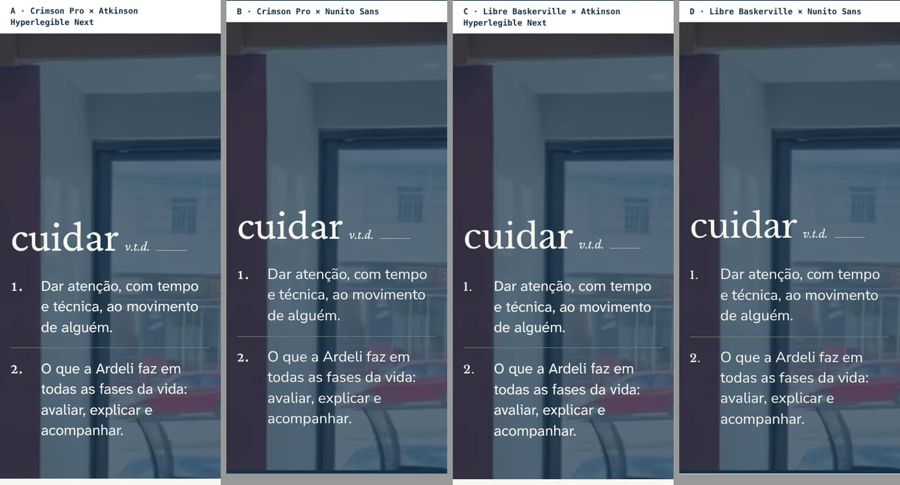
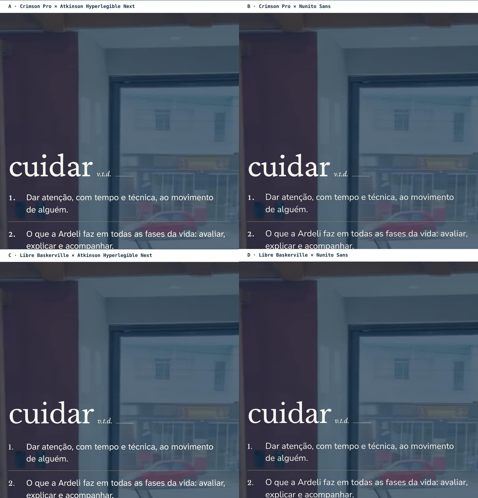
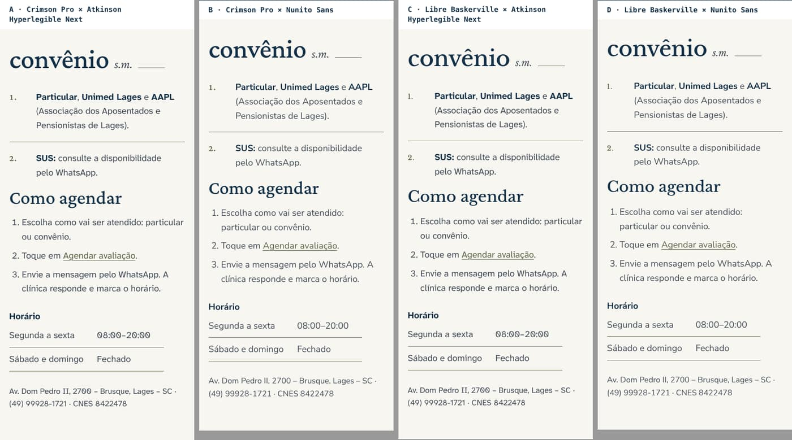
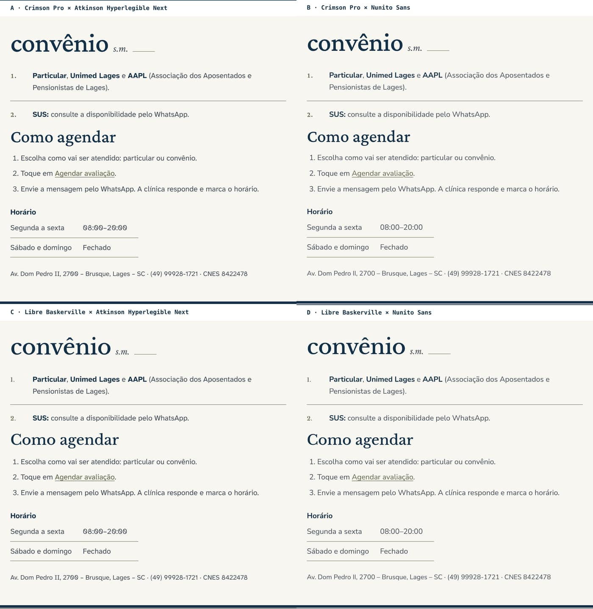
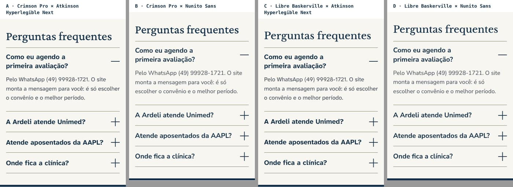
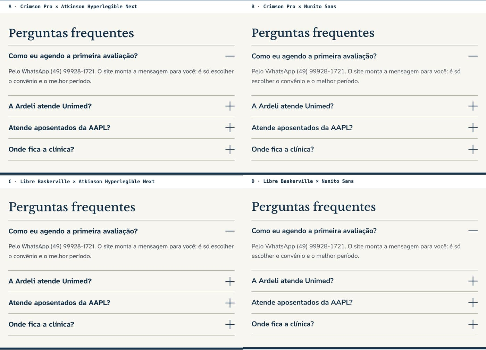

# Tipografia — decisão

22/11/2026 · sessão "design system"

**Escolha: A — Crimson Pro (verbetes e títulos) × Atkinson Hyperlegible Next (leitura).**

## Como foi testado

Uma rota temporária com as 4 combinações (2 serifas × 2 sem-serifas) em 3 provas reais, cada uma a 390 px, 1440 px e 1440 px com zoom de 200%:

1. **Verbete de capa:** "cuidar *v.t.d.*" com 2 acepções sobre foto com véu Marinho.
2. **Convênios:** verbete "convênio *s.m.*", passos numerados, tabela de horário com números tabulares, endereço e telefone.
3. **FAQ:** perguntas em `
` com a resposta aberta.

Capturas (A no alto à esquerda, B no alto à direita, C embaixo à esquerda, D embaixo à direita, no zoom 200%; em fila A–D a 390 px):

| Prova | 390 px | Zoom 200% |
|---|---|---|
| Capa |  |  |
| Convênios |  |  |
| FAQ |  |  |

## Os arquivos (lidos das tabelas OpenType, subset latino)

| Fonte | Eixos | Licença | Altura-x | Algarismos | Versalete | Peso |
|---|---|---|---|---|---|---|
| Crimson Pro | wght 200–900 (+ itálico) | OFL 1.1 | 0,42 | proporcionais; `tnum` disponível | não | 47 KB |
| Libre Baskerville | wght 400–700 (+ itálico) | OFL 1.1 | 0,53 | proporcionais; **sem `tnum`** | não | 33 KB |
| Atkinson Hyperlegible Next | wght 200–800 (+ itálico) | OFL 1.1 | 0,50 | proporcionais; `tnum` disponível; **zero cortado** | não | 33 KB |
| Nunito Sans | wght 200–1000, wdth 75–125, opsz 6–12, YTLC 440–540 | OFL 1.1 | 0,48 | tabulares por padrão (sem `tnum`) | não | 31 KB (só wght) |

Todas têm os acentos e sinais do português (ã õ ç â ê ô à, travessão, aspas curvas, ponto médio).

## Por quê

**Serifa: Crimson Pro, não Libre Baskerville.**
- O verbete precisa ser **limpo e contemporâneo**, não "dicionário antigo". A Crimson Pro é uma serifa de livro desenhada em 2018. A Baskerville é revival do século XVIII: larga e pesada no tamanho de capa (ver "cuidar" e "convênio" nas provas), puxa para o envelhecido.
- O eixo de peso de 200 a 900 permite a palavra da capa fina (400) e a de seção um pouco mais firme (500) **com o mesmo arquivo**.
- A altura-x baixa (0,42) só pesa em texto pequeno, e a serifa só aparece grande: palavra do verbete, títulos e o numeral das acepções.
- Tem `tnum`. A Baskerville não tem.

**Leitura: Atkinson Hyperlegible Next, não Nunito Sans.**
- Foi desenhada pelo Braille Institute para **baixa visão**, que é o público (aposentados, pós-operatório). As letras que costumam se confundir são diferentes de propósito: **I maiúsculo × l minúsculo × 1**, **0 × O** (zero cortado), b/d, p/q.
- Na prova de convênios, a Nunito escreve "Dom Pedro **II**" com dois traços iguais aos de "ll" ou "11". Na Atkinson, o "II" é inequívoco.
- O zero cortado ("08:00", "2700", "99928-1721") ajuda a ler e discar o telefone certo. É uma escolha de legibilidade, não de estilo.
- Mesmo peso nominal, a Atkinson rende mais escura e firme que a Nunito, que parece cinza claro nas capturas. Para quem enxerga pior, isso conta mais que suavidade.
- Tem `tnum`, usado no horário.
- A Nunito tem mais eixos, mas o projeto não precisa de largura nem de tamanho óptico.

**O que se perde:** a Atkinson é um pouco mais larga (cabe menos por linha) e mais "técnica" que a Nunito. Compensação: medida de 64 caracteres, entrelinha 1,6 e o tom humano vindo da serifa e das fotos.

## Como está aplicado

- `--fonte-serifa`: Crimson Pro (palavra do verbete, títulos, classe gramatical em itálico, numeral das acepções).
- `--fonte-texto`: Atkinson Hyperlegible Next (todo o resto).
- Base: **18 px** (`html { font-size: 112.5% }`, respeitando o tamanho escolhido no navegador); entrelinha **1,6**. A+ = 20 px e A++ = 22 px.
- `font-variant-numeric: tabular-nums` em `<time>` e `.num` (horário).
- Fontes self-hosted pela API de fontes do Astro (provedor local), só no subset latino, com fallback de métricas ajustadas (CLS ≈ 0) e `font-size-adjust: ex-height from-font`. Licenças em `src/assets/fontes/OFL-*.txt`.
- **Versalete:** nenhuma das 4 tem `smcp`. O numeral das acepções é composto em Crimson Pro, a 0,82 em, peso 600 e espaçamento de 0,06 em, na altura das minúsculas.
